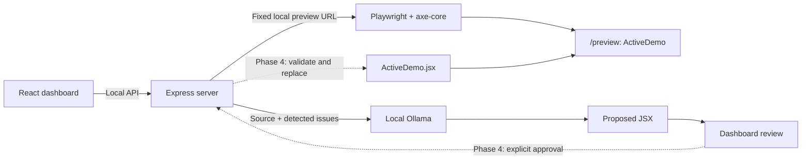

# AccessFix AI architecture

AccessFix AI is a local hackathon prototype for one predefined React component. Its intended workflow is **Detect → Generate → Review → Approve → Apply → Verify**. Phases 0–3 implement the local foundation, dashboard, controlled preview, real detection and AI proposal generation/review. Application, reset and after-repair verification remain Phase 4 work.

## Local services

- **Client:** React, Vite, JavaScript and Tailwind CSS. The existing dashboard triggers scans, presents genuine findings/baselines and displays the model's JSX proposal as text alongside its original source. The separate `/preview` route still renders only `ActiveDemo`. The dashboard embeds that same-origin route in an iframe with a descriptive title.
- **Server:** Node.js and Express. `/api/health`, `POST /api/scan` and `POST /api/generate-fix` are implemented. The server retains a small in-memory association between the current scan, source fingerprint and proposal. It never accepts uploaded code, findings, paths or inference URLs. A public source endpoint and applying approved changes remain future work.
- **Browser automation:** Playwright with `@axe-core/playwright`, running its bundled headless Chromium against the configured local client preview. Each scan owns fresh browser/context resources and releases them on completion or failure. Missing Chromium produces an explicit error; installed Chrome/Edge is not silently substituted.
- **Inference:** A real local Ollama service using configured `qwen2.5-coder:1.5b` by default. The HTTP client uses `/api/chat`, system/user messages, `stream: false` and temperature 0.1. Model unavailability or malformed output is an error; there is no fabricated response or fallback patch.
- **Syntax validation:** `@babel/parser` parses proposed module text and checks that it has a default-exported function component returning JSX. An explicit prototype policy rejects unsupported capabilities. No generated module is compiled, imported, evaluated or rendered in Phase 3.



The browser uses relative `/api` requests through Vite's development proxy. Server configuration supplies the client and Ollama URLs, model and timeouts. Bind the development services to loopback; no deployment, account, database or hosted inference is required.

The dashboard reads ordinary module views through `OriginalDemo.jsx?raw` and `ActiveDemo.jsx?raw` imports. Proposal review uses the exact original source returned by the generation request and the validated model output, with text-only rendering and copy controls. The generated panel is labeled **“AI-generated proposal — not yet applied or verified.”** `Routes.jsx` loads the preview independently; it never receives or imports proposed code. Direct `/preview` loads exclude dashboard code and raw source imports. API health checks connectivity only, not browser/model readiness.

## Source layout

```text
client/                         React/Vite application
  src/
    Routes.jsx                  Dashboard/preview route selection
    preview/
      Preview.jsx               Isolated ActiveDemo entry
      preview.css               Preview-only styles
    demo/                       Implemented in Phase 1
      OriginalDemo.jsx          Deliberately inaccessible baseline
      ActiveDemo.jsx            Sole runtime-editable source file
    hooks/                      Scan and AI request/lifecycle state
server/
  src/
    app.js                      Health/scan/generate endpoints and memory associations
    services/
      accessibilityScanner.js   Browser orchestration and cleanup
      normalizeScan.js          Genuine axe result normalization
      buildRepairPrompt.js      Actual controlled source and scan prompt
      ollamaClient.js           Bounded local Ollama HTTP calls
      validateProposal.js       JSX normalization and prototype policy
      fixGenerator.js           Source-bound generation and one correction attempt
  test/                         Configuration, HTTP, scanner, AI and validation tests
docs/architecture.md            Architecture and phase boundaries
```

`OriginalDemo.jsx` is the future reset baseline. No Phase 2 or 3 API modifies either demo file. The future apply/reset APIs may write only `ActiveDemo.jsx`; paths are resolved by the server from its own project location, never from a request. Development work may of course edit the repository normally.

Both demo modules initially contain the same complete component; `ActiveDemo.jsx` does not import the original baseline. Their deliberate defects are unnamed email/password inputs, an unnamed icon-only password visibility button and low-contrast helper text. All intentional violations stay inside this fixture. Submission is a local interaction with no authentication, network request or storage.

## API contracts

`GET /api/health` preserves its original response and tests, including `phase: 0`; that compatibility field is not the current product milestone. `POST /api/scan` and `POST /api/generate-fix` are implemented. Public source, apply and reset endpoints remain planned and return JSON 404 errors. Errors use a consistent shape such as `{ "error": { "code": "OLLAMA_UNAVAILABLE", "message": "…" } }`, with useful HTTP status codes and no stack traces in browser responses.

| Endpoint | Input | Successful response and behavior | Phase |
| --- | --- | --- | --- |
| `GET /api/demo` | None | Reserved read-only endpoint for current source, original source and current source fingerprint. Phase 1 instead uses Vite raw imports. | Future backend source integration |
| `POST /api/scan` | Empty request or `{}` only; no query, URL, source or path input | Implemented: genuine axe report for the fixed preview, associated with the current source fingerprint and shared testing configuration. | 2 |
| `POST /api/generate-fix` | JSON `{ "scanId": "current completed scan identifier" }` only | Implemented: read fixed current source, check its scan fingerprint, call actual Ollama, validate and return/store a source-bound proposal. Never write or execute it. | 3 |
| `POST /api/apply-and-verify` | Candidate identifier and explicit approval | Reject stale or unapproved candidates; validate, apply, render and rescan. Return the actual before/after reports and remaining violations, or an error with rollback status. | 4 |
| `POST /api/reset` | None | Restore the controlled original source, invalidate saved scans/candidates and return the new source fingerprint. | 4 |

The frontend retains its first successful scan as the baseline and later successful scans as the latest report, in React application memory. Failed requests do not overwrite successful scan reports; retained latest results are clearly identified when a rescan fails. A page reload clears this state. The before card displays the real initial baseline; the after card remains unverified.

The server keeps only a revision counter, current completed scan, first baseline and current proposal for the one controlled component. A new scan invalidates the current scan/proposal and aborts generation already in progress, so a failed new scan cannot authorize generation from an older report. Restarting Express clears all associations. The client must scan again after source changes or restart. The future apply endpoint will accept a stored proposal identifier rather than arbitrary replacement code; it is not implemented here.

The dashboard enables **Scan Accessibility** and enables **Generate AI Fix** only after a successful current scan with violations. Both operations have loading/error/retry states and duplicate-request protection. Starting a new scan invalidates stale proposal state, including responses that arrive after cancellation. **Apply & Verify** and **Reset Demo** stay disabled. Navigation, preview links, text copying and API health/retry remain available.

## Phase 2 scan contract and trust boundary

The scan route does not accept target URLs, source, selectors, filesystem paths or query options. It uses the validated local `PREVIEW_URL` from server configuration, restricted to `/preview` on `CLIENT_ORIGIN`. A browser's `Origin`, when present, must match `CLIENT_ORIGIN`, and cross-site browser requests are rejected. Local CLI requests can omit `Origin`. A server-process lock admits one scan at a time and rejects overlap with HTTP 409 `SCAN_IN_PROGRESS`; the frontend also disables its scan control while a request is pending.

`accessibilityScanner.js` launches headless Chromium, opens a fresh context, navigates with a bounded timeout and waits for the visible `[data-testid="active-demo"][data-demo-ready="true"]` marker. Compilation/runtime problems and unexpected navigation are failures, not clean scans. The overall scan time budget also covers analysis. Browser resources are released in failure paths as well as success paths.

The shared policy identifier is `accessfix-axe-v1`. Its fixed viewport is 1280 × 800, color scheme is light, motion preference is reduced and axe uses all default enabled rules. There are no impact filters, contrast exclusions or separate rule sets for future verification. Return the policy and engine version with the report so later comparisons can check that their configurations match.

The normalized result has this structure:

```text
status: "completed"
scanId, scannedAt, previewUrl, sourceHash
configuration: policy identifier and actual engine/testing settings
violatedRuleCount: distinct violated rules
affectedElementCount: unique selector paths across all violation nodes
severityBreakdown: critical / serious / moderate / minor / unclassified RULE counts
incompleteRuleCount: rules requiring further review
violations[]:
  id, help, description, recommendedAction, impact
  tags, wcagTags, helpUrl, affectedElementCount
  nodes[]: target, html, impact, failureSummary, checks { any, all, none }
```

`normalizeScan.js` derives these fields from genuine axe output, preserving relevant node and remediation details. A rule may affect several elements, and an element may violate several rules; rule and element counts must never be presented as interchangeable. Missing impacts are classified as `unclassified`, not silently discarded. Malformed analysis output is an error rather than a zero-count result.

Expected errors include missing/failed Chromium (503), unavailable preview (503), scan timeout (504), failed preview rendering (422), overlapping scan or source change (409), rejected input (400/403/415) and unexpected analysis failure (500). The scanner reads the controlled `ActiveDemo.jsx` before and after analysis and rejects a changing SHA-256 fingerprint. It never writes source. Neither a failed scan nor a failed request erases the retained frontend baseline.

The observed Phase 2 endpoint scan used bundled Chromium and axe-core 4.14.0, returning three violated rules across four unique elements: `label` covered both unnamed inputs, `button-name` covered the unnamed icon button and `color-contrast` covered the helper text. The severity breakdown was two critical rules and one serious rule, with zero incomplete rules. Source bytes stayed unchanged and the browser disconnected after completion. See the [actual response excerpt](../README.md#observed-phase-2-scan); these observations are not hardcoded scan output.

## Phase 3 generation contract and trust boundary

The generation request accepts exactly one `scanId`, never a source string, model URL, filesystem path or submitted report. The server requires a completed current scan with findings and reads `ActiveDemo.jsx` from the established fixed path. Its SHA-256 must match before and after generation. One global generation job runs at a time; duplicate jobs receive HTTP 409. Starting a new scan aborts that job and makes its result stale. Browser origin checks match those used by scanning; local CLI requests may omit `Origin`.

`buildRepairPrompt.js` includes actual source, observed axe rule IDs/descriptions, affected selectors/HTML, failure summaries and check guidance. Instructions ask for semantic labels, named icon controls and improved contrast while preserving existing styling, imports/hooks, default component and local interaction behavior. Source and findings are treated as data, and the model is asked for one complete code-only JSX module.

`ollamaClient.js` uses the validated server-side local origin and configured tag. It calls `/api/chat` with temperature 0.1, `stream: false`, a 4096-token output request and an 8192-token context. Response content comes only from `message.content`. The configured generation deadline covers response headers/body and at most one correction request after invalid/unsupported JSX. Default limits are 262144 response bytes and 65536 module bytes, with environment validation caps of 1048576 and 131072 respectively. Empty, incomplete, oversized, malformed or model-error responses fail explicitly.

The proposal response is:

```text
status: "proposed"
proposalId, scanId, model, generatedAt, sourceHash
originalCode: the exact controlled source used in the prompt
proposedCode: complete normalized/validated JSX text
applied: false
verified: false
```

`validateProposal.js` trims whitespace, strips one complete surrounding Markdown fence if present and parses JSX with `@babel/parser`. It requires exactly one default-exported synchronous React function component that returns JSX. The exported `PROPOSAL_POLICY` explicitly limits imports to React and rejects module-scope effects, non-pure constants, classes/constructors, asynchronous/generator constructs, dynamic imports/execution, process/filesystem/network/browser-storage/global capabilities, embedded scripts/documents, executable HTML injection and external resource/form/link targets. Normal inline styles, JSX, React hooks and local event handlers remain supported. The policy is deliberately limited to this demo, not a complete JavaScript sandbox.

Phase 3 only displays and copies proposal text. It does not evaluate or compile that text, mount it in an iframe, scan it, write component files or claim that accessibility issues are fixed. The preview is still the unchanged active demo. Future Phase 4 must revalidate the stored proposal and source association before any explicitly approved write, then perform genuine verification and recovery.

Expected generation errors include unavailable/missing Ollama/model (503), timeout (504), model/protocol/oversize failures (502), missing/stale/busy scan or generation association (409), no detected violations or invalid/unsupported JSX (422), unsupported input (400/403/415) and unexpected orchestration failures (500). These failures have no prepared JSX fallback. See the [generation workflow and commands](../README.md#generate-an-ai-proposal).

## Detection and verification

1. Open the server-configured local `/preview` URL in a fresh browser context and wait for the component's ready signal and successful rendering.
2. Run one shared axe configuration for both baseline and verification: identical rules/tags, viewport, browser settings, page scope and readiness conditions. Store its identity with each report.
3. Normalize real axe violations into rule ID, impact, description, help text/link and affected nodes. Each affected node includes targets and the actionable failure summary returned by axe.
4. Preserve the raw meaning of results. A failed browser launch, navigation, compilation, rendering or scan is an error, never a zero-violation report.
5. Compare matching baseline and verification reports, showing counts, impacts, resolved rules and remaining problems. An applied candidate can still have accessibility violations.

For a completed scan with zero violations, use **“No accessibility violations were detected by the automated scan.”** Automated testing does not establish full WCAG compliance; review incomplete checks and continue keyboard, screen-reader and other manual assessments.

## Future Phase 4 approval and safe application

1. Require the user's explicit Apply & Verify action for a stored proposal; generation alone never grants approval.
2. Revalidate the complete proposed module and its allowed capabilities. **Parsing JSX is not a sandbox**, so Phase 3 acceptance must not be treated as proof that arbitrary code is safe to run.
3. Serialize source-changing operations, recheck the source fingerprint and preserve the previous source before replacing only `ActiveDemo.jsx`.
4. Wait for Vite to compile and the updated preview to render. Detect compilation errors, runtime exceptions and failed readiness before running the same accessibility scan again.
5. If application, compilation, rendering or verification fails, restore the preserved source and confirm that the previous preview renders. Report both the primary failure and rollback outcome. Never overwrite `OriginalDemo.jsx` or substitute a hand-written repair.

Use bounded timeouts and close browser contexts on all paths. Distinguish service-unavailable, timeout, malformed-model-output, stale-candidate, validation, browser and rollback errors so the dashboard can explain a useful next step.

## Scope and phase gates

| Phase | Deliverable | Gate before continuing |
| --- | --- | --- |
| **0 — Setup and architecture** | Client/server scaffolding, dependencies, environment examples, startup/check scripts and architecture documentation. | Build and available foundation checks pass; summarize changes and stop. |
| **1 — Frontend dashboard and demo** | Implemented: accessible dashboard, deliberately buggy baseline, active component, isolated preview and Vite raw source loading. | Check frontend build, dashboard/preview rendering and health proxy; summarize and stop. |
| **2 — Accessibility detection engine** | Implemented: fixed-target Playwright/axe scan, genuine issue details, count/severity reporting and in-memory baseline. | Exercise baseline scan, repeatable configuration, failure/concurrency paths and source immutability; summarize and stop. |
| **3 — AI-generated fix engine** | Implemented: local Ollama HTTP inference, actual-source/findings prompt, JSX/policy validation, stored proposal association and side-by-side text review. | Exercise model success and unavailable/timeout/malformed output paths; confirm generation leaves the source unchanged; summarize and stop. |
| **4 — Apply-and-verify workflow** | Explicit approval, stale-source protection, controlled writes, rollback, genuine verification and reset. | Exercise the complete workflow and failed-application recovery; summarize and stop. |
| **5 — Testing, documentation and demo preparation** | Integration checks, manual accessibility checks, troubleshooting and reproducible demo instructions. | Demonstrate Detect → Fix → Verify with the real local model and actual scan reports. |

No phase includes arbitrary repository uploads, user-provided scan URLs, authentication, databases, payments or cloud deployment. Do not begin the next phase until the user requests it.
