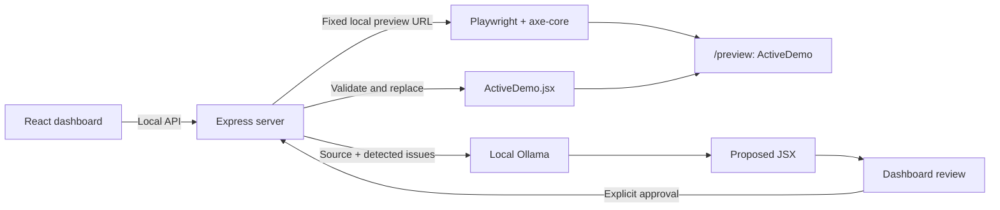

# AccessFix AI architecture

AccessFix AI is a local hackathon prototype for one predefined React component. Its intended workflow is **Detect → Generate → Review → Approve → Apply → Verify**. Phases 0–2 implement the local foundation, dashboard, controlled preview and real accessibility detection. Inference, application, reset and after-repair verification remain planned work.

## Local services

- **Client:** React, Vite, JavaScript and Tailwind CSS. The existing dashboard triggers scans and presents genuine findings, source and baseline results. The separate `/preview` route renders only `ActiveDemo`, without dashboard controls that could affect its scan results. The dashboard embeds that same-origin route in an iframe with a descriptive title.
- **Server:** Node.js and Express. `/api/health` and `POST /api/scan` are implemented. It validates scan requests and coordinates the fixed-target browser scan. Reading source through a public API, calling Ollama, validating candidates and applying approved changes remain future integrations.
- **Browser automation:** Playwright with `@axe-core/playwright`, running its bundled headless Chromium against the configured local client preview. Each scan owns fresh browser/context resources and releases them on completion or failure. Missing Chromium produces an explicit error; installed Chrome/Edge is not silently substituted.
- **Inference:** A real local Ollama service using `qwen2.5-coder:1.5b`. Model unavailability is an error; there is no fabricated response or fallback patch.
- **Syntax validation:** `@babel/parser` will parse each proposed complete JSX module and verify that it has a default-exported React component.



The browser uses relative `/api` requests through Vite's development proxy. Server configuration supplies the client and Ollama URLs, model and timeouts. Bind the development services to loopback; no deployment, account, database or hosted inference is required.

The dashboard reads actual module text through `OriginalDemo.jsx?raw` and `ActiveDemo.jsx?raw` imports. The AI source panel remains empty until a real proposal exists. `Routes.jsx` loads the preview entry independently of the dashboard; `preview/Preview.jsx` renders only `ActiveDemo` with isolated preview styles. Direct `/preview` loads exclude dashboard code and raw source imports. The dashboard checks API health on load and on explicit recheck, without implying that a browser or model is ready.

## Source layout

```text
client/                         React/Vite application
  src/
    Routes.jsx                  Dashboard/preview route selection
    preview/
      Preview.jsx               Isolated ActiveDemo entry
      preview.css               Preview-only styles
    demo/                       Implemented in Phase 1
      OriginalDemo.jsx          Deliberately inaccessible baseline
      ActiveDemo.jsx            Sole runtime-editable source file
    hooks/                      Scan request and lifecycle state
server/
  src/
    app.js                      Health and fixed-target scan endpoints
    services/
      accessibilityScanner.js   Browser orchestration and cleanup
      normalizeScan.js          Genuine axe result normalization
  test/                         Configuration, HTTP, scanner and normalization tests
docs/architecture.md            Architecture and phase boundaries
```

`OriginalDemo.jsx` is the future reset baseline. No Phase 2 API modifies either demo file. The future apply/reset APIs may write only `ActiveDemo.jsx`; paths are resolved by the server from its own project location, never from a request. Development work may of course edit the repository normally.

Both demo modules initially contain the same complete component; `ActiveDemo.jsx` does not import the original baseline. Their deliberate defects are unnamed email/password inputs, an unnamed icon-only password visibility button and low-contrast helper text. All intentional violations stay inside this fixture. Submission is a local interaction with no authentication, network request or storage.

## API contracts

`GET /api/health` preserves its original response and tests, including `phase: 0`; that compatibility field is not the current product milestone. `POST /api/scan` is implemented in Phase 2. All other workflow endpoints below remain planned and return JSON 404 errors. Errors use a consistent shape such as `{ "error": { "code": "PREVIEW_UNAVAILABLE", "message": "…" } }`, with useful HTTP status codes and no stack traces in browser responses.

| Endpoint | Input | Successful response and behavior | Phase |
| --- | --- | --- | --- |
| `GET /api/demo` | None | Reserved read-only endpoint for current source, original source and current source fingerprint. Phase 1 instead uses Vite raw imports. | Future backend source integration |
| `POST /api/scan` | Empty request or `{}` only; no query, URL, source or path input | Implemented: genuine axe report for the fixed preview, associated with the current source fingerprint and shared testing configuration. | 2 |
| `POST /api/generate-fix` | A current scan identifier | Send the server's current source and actual issues to Ollama; return a validated, stored candidate with identifier, proposed source and base fingerprint. Do not write the component. | 3 |
| `POST /api/apply-and-verify` | Candidate identifier and explicit approval | Reject stale or unapproved candidates; validate, apply, render and rescan. Return the actual before/after reports and remaining violations, or an error with rollback status. | 4 |
| `POST /api/reset` | None | Restore the controlled original source, invalidate saved scans/candidates and return the new source fingerprint. | 4 |

The Phase 2 frontend retains the first successful scan as its baseline and later successful scans as the latest report, in React application memory. Failed requests do not overwrite successful reports; retained latest results are clearly identified when a rescan fails. A page reload clears this state. The before card may display the genuine baseline; the after card remains unverified. No database or server-side persistence is needed for this milestone.

Later phases will need server-held scans/candidates associated with source fingerprints. Restarting the server will invalidate those records. The client must request a fresh scan after a source change, and the future apply endpoint will accept a stored candidate identifier rather than arbitrary replacement code.

The dashboard enables **Scan Accessibility**, shows pending/error states, renders actual findings and permits retry. It keeps **Generate AI Fix**, **Apply & Verify** and **Reset Demo** disabled with visible explanations. Navigation, opening the preview, copying source and checking/retrying API health remain available. Reset is disabled because restoration is not implemented.

## Phase 2 scan contract and trust boundary

The scan route does not accept target URLs, source, selectors, filesystem paths or query options. It uses the validated local `PREVIEW_URL` from server configuration, restricted to `/preview` on `CLIENT_ORIGIN`. A browser's `Origin`, when present, must match `CLIENT_ORIGIN`, and cross-site browser requests are rejected. Local CLI requests can omit `Origin`. A server-process lock admits one scan at a time and rejects overlap with HTTP 409 `SCAN_IN_PROGRESS`; the frontend also disables its scan control while a request is pending.

`accessibilityScanner.js` launches headless Chromium, opens a fresh context, navigates with a bounded timeout and waits for the visible `[data-testid="active-demo"][data-demo-ready="true"]` marker. Compilation/runtime problems and unexpected navigation are failures, not clean scans. The overall scan time budget also covers analysis. Browser resources are released in failure paths as well as success paths.

The shared policy identifier is `accessfix-axe-v1`. Its fixed viewport is 1280 × 800, color scheme is light, motion preference is reduced and axe uses all default enabled rules. There are no impact filters, contrast exclusions or separate rule sets for future verification. Return the policy and engine version with the report so later comparisons can check that their configurations match.

The normalized result has this structure:

```text
status: "completed"
scanId, scannedAt, previewUrl, sourceHash
configuration: policy identifier and actual engine/testing settings
violatedRuleCount: distinct violated rules
affectedElementCount: unique selector paths across all violation nodes
severityBreakdown: critical / serious / moderate / minor / unclassified RULE counts
incompleteRuleCount: rules requiring further review
violations[]:
  id, help, description, recommendedAction, impact
  tags, wcagTags, helpUrl, affectedElementCount
  nodes[]: target, html, impact, failureSummary, checks { any, all, none }
```

`normalizeScan.js` derives these fields from genuine axe output, preserving relevant node and remediation details. A rule may affect several elements, and an element may violate several rules; rule and element counts must never be presented as interchangeable. Missing impacts are classified as `unclassified`, not silently discarded. Malformed analysis output is an error rather than a zero-count result.

Expected errors include missing/failed Chromium (503), unavailable preview (503), scan timeout (504), failed preview rendering (422), overlapping scan or source change (409), rejected input (400/403/415) and unexpected analysis failure (500). The scanner reads the controlled `ActiveDemo.jsx` before and after analysis and rejects a changing SHA-256 fingerprint. It never writes source. Neither a failed scan nor a failed request erases the retained frontend baseline.

The observed Phase 2 endpoint scan used bundled Chromium and axe-core 4.14.0, returning three violated rules across four unique elements: `label` covered both unnamed inputs, `button-name` covered the unnamed icon button and `color-contrast` covered the helper text. The severity breakdown was two critical rules and one serious rule, with zero incomplete rules. Source bytes stayed unchanged and the browser disconnected after completion. See the [actual response excerpt](../README.md#observed-phase-2-scan); these observations are not hardcoded scan output.

## Detection and verification

1. Open the server-configured local `/preview` URL in a fresh browser context and wait for the component's ready signal and successful rendering.
2. Run one shared axe configuration for both baseline and verification: identical rules/tags, viewport, browser settings, page scope and readiness conditions. Store its identity with each report.
3. Normalize real axe violations into rule ID, impact, description, help text/link and affected nodes. Each affected node includes targets and the actionable failure summary returned by axe.
4. Preserve the raw meaning of results. A failed browser launch, navigation, compilation, rendering or scan is an error, never a zero-violation report.
5. Compare matching baseline and verification reports, showing counts, impacts, resolved rules and remaining problems. An applied candidate can still have accessibility violations.

For a completed scan with zero violations, use **“No accessibility violations were detected by the automated scan.”** Automated testing does not establish full WCAG compliance; review incomplete checks and continue keyboard, screen-reader and other manual assessments.

## Generation, approval and safe application

1. Build the prompt from the controlled source and server-held scan. Request a complete JSX module with one default-exported React component and no explanation or Markdown.
2. Call local Ollama with a bounded timeout and response size. Remove surrounding Markdown fences if present, then parse and validate the full returned module. Reject incomplete, malformed or unexpected responses without changing any file.
3. Enforce a narrow component capability policy: permit the expected React imports and component structure; reject unexpected imports, dynamic execution, module-scope side effects and unrelated network or storage behavior. **Parsing JSX validates syntax; it is not a JavaScript sandbox.** No uploaded code or arbitrary repositories are accepted.
4. Store the candidate against the exact source fingerprint used to generate it. Display original and proposed source for review. Generation itself never applies a change.
5. Require the user's explicit Apply & Verify action. Serialize source-changing operations, recheck the base fingerprint and preserve the previous source before replacing `ActiveDemo.jsx`.
6. Wait for Vite to compile and the updated preview to render. Detect compilation errors, runtime exceptions and failed readiness before running the same accessibility scan again.
7. If application, compilation, rendering or verification fails, restore the preserved source and confirm that the previous preview renders. Report both the primary failure and rollback outcome. Do not overwrite `OriginalDemo.jsx` or silently substitute a hand-written fix.

Use bounded timeouts and close browser contexts on all paths. Distinguish service-unavailable, timeout, malformed-model-output, stale-candidate, validation, browser and rollback errors so the dashboard can explain a useful next step.

## Scope and phase gates

| Phase | Deliverable | Gate before continuing |
| --- | --- | --- |
| **0 — Setup and architecture** | Client/server scaffolding, dependencies, environment examples, startup/check scripts and architecture documentation. | Build and available foundation checks pass; summarize changes and stop. |
| **1 — Frontend dashboard and demo** | Implemented: accessible dashboard, deliberately buggy baseline, active component, isolated preview and Vite raw source loading. | Check frontend build, dashboard/preview rendering and health proxy; summarize and stop. |
| **2 — Accessibility detection engine** | Implemented: fixed-target Playwright/axe scan, genuine issue details, count/severity reporting and in-memory baseline. | Exercise baseline scan, repeatable configuration, failure/concurrency paths and source immutability; summarize and stop. |
| **3 — AI-generated fix engine** | Real Ollama inference, prompt constraints, JSX validation and side-by-side candidate review. | Exercise model success and unavailable/timeout/malformed output paths; confirm generation leaves the source unchanged; summarize and stop. |
| **4 — Apply-and-verify workflow** | Explicit approval, stale-source protection, controlled writes, rollback, genuine verification and reset. | Exercise the complete workflow and failed-application recovery; summarize and stop. |
| **5 — Testing, documentation and demo preparation** | Integration checks, manual accessibility checks, troubleshooting and reproducible demo instructions. | Demonstrate Detect → Fix → Verify with the real local model and actual scan reports. |

No phase includes arbitrary repository uploads, user-provided scan URLs, authentication, databases, payments or cloud deployment. Do not begin the next phase until the user requests it.
