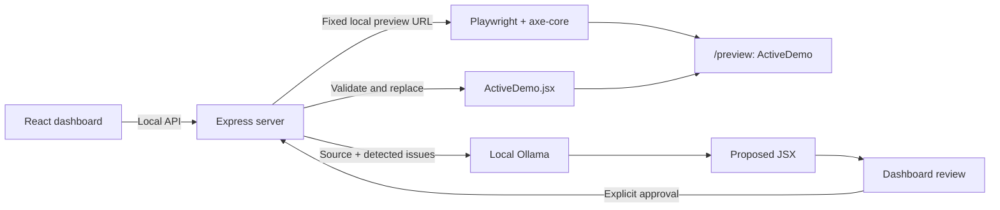

# AccessFix AI architecture

AccessFix AI is a local hackathon prototype for one predefined React component. Its intended workflow is **Detect → Generate → Review → Approve → Apply → Verify**. Phase 0 provides the development foundation. Phase 1 implements the dashboard, controlled demo, isolated preview and raw source display. Scanning, inference, application and reset remain planned work.

## Local services

- **Client:** React, Vite, JavaScript and Tailwind CSS. The dashboard displays the component, source comparison and clearly unavailable workflow controls. The separate `/preview` route renders only `ActiveDemo`, without dashboard controls that could affect its future scan results. The dashboard embeds that same-origin route in an iframe with a descriptive title.
- **Server:** Node.js and Express. The existing `/api/health` endpoint is implemented. Reading source through the API, coordinating scans, calling Ollama, validating candidates and applying approved changes are planned backend integrations.
- **Browser automation:** Playwright with `@axe-core/playwright`, running Chromium against the configured local client preview. The browser is test infrastructure, not an arbitrary URL scanning service.
- **Inference:** A real local Ollama service using `qwen2.5-coder:1.5b`. Model unavailability is an error; there is no fabricated response or fallback patch.
- **Syntax validation:** `@babel/parser` will parse each proposed complete JSX module and verify that it has a default-exported React component.



The browser uses relative `/api` requests through Vite's development proxy. Server configuration supplies the client and Ollama URLs, model and timeouts. Bind the development services to loopback; no deployment, account, database or hosted inference is required.

In Phase 1, the dashboard reads actual module text through `OriginalDemo.jsx?raw` and `ActiveDemo.jsx?raw` imports. The AI source panel remains empty until a real proposal exists. `Routes.jsx` loads the preview entry independently of the dashboard; `preview/Preview.jsx` renders only `ActiveDemo` with isolated preview styles. Direct `/preview` loads exclude dashboard code and raw source imports. The dashboard checks API health on load and on explicit recheck, without implying that a browser or model is ready.

## Source layout

```text
client/                         React/Vite application
  src/
    Routes.jsx                  Dashboard/preview route selection
    preview/
      Preview.jsx               Isolated ActiveDemo entry
      preview.css               Preview-only styles
    demo/                       Implemented in Phase 1
      OriginalDemo.jsx          Deliberately inaccessible baseline
      ActiveDemo.jsx            Sole runtime-editable source file
server/                         Express application
docs/architecture.md            Architecture and phase boundaries
```

`OriginalDemo.jsx` is the reset baseline. Only `ActiveDemo.jsx` may be modified by the application's API. Paths are resolved by the server from its own project location, never from a request. Development work may of course edit the repository normally.

Both demo modules initially contain the same complete component; `ActiveDemo.jsx` does not import the original baseline. Their deliberate defects are unnamed email/password inputs, an unnamed icon-only password visibility button and low-contrast helper text. All intentional violations stay inside this fixture. Submission is a local interaction with no authentication, network request or storage.

## Planned API contracts

Only `GET /api/health` is implemented in Phase 1, preserving its Phase 0 response and tests. Its `phase: 0` field describes the API milestone, not the client milestone. The contracts below describe future backend behavior. All listed endpoints currently return JSON 404 errors. Return future errors in a consistent shape such as `{ "error": { "code": "MODEL_UNAVAILABLE", "message": "…" } }`, with useful HTTP status codes and no stack traces in browser responses.

| Endpoint | Input | Successful response and behavior | Phase |
| --- | --- | --- | --- |
| `GET /api/demo` | None | Reserved read-only endpoint for current source, original source and current source fingerprint. Phase 1 instead uses Vite raw imports. | Future backend source integration |
| `POST /api/scan` | No URL or source input | A genuine axe report for the fixed preview, associated with the current source fingerprint and testing configuration. | 2 |
| `POST /api/generate-fix` | A current scan identifier | Send the server's current source and actual issues to Ollama; return a validated, stored candidate with identifier, proposed source and base fingerprint. Do not write the component. | 3 |
| `POST /api/apply-and-verify` | Candidate identifier and explicit approval | Reject stale or unapproved candidates; validate, apply, render and rescan. Return the actual before/after reports and remaining violations, or an error with rollback status. | 4 |
| `POST /api/reset` | None | Restore the controlled original source, invalidate saved scans/candidates and return the new source fingerprint. | 4 |

Keep scan and candidate records in process memory for this prototype. Restarting the server invalidates those records. The client must request a fresh scan after a source change. The apply endpoint accepts a stored candidate identifier rather than arbitrary replacement code.

The current dashboard disables **Scan Accessibility**, **Generate AI Fix**, **Apply & Verify** and **Reset Demo**, with visible explanations. Navigation links, opening the preview, copying source and checking/retrying API health are the available dashboard interactions. Before/after and issue sections indicate that no scan or verification has run. Reset is disabled because the server does not yet implement restoration.

## Detection and verification

1. Open the server-configured local `/preview` URL in a fresh browser context and wait for the component's ready signal and successful rendering.
2. Run one shared axe configuration for both baseline and verification: identical rules/tags, viewport, browser settings, page scope and readiness conditions. Store its identity with each report.
3. Normalize real axe violations into rule ID, impact, description, help text/link and affected nodes. Each affected node includes targets and the actionable failure summary returned by axe.
4. Preserve the raw meaning of results. A failed browser launch, navigation, compilation, rendering or scan is an error, never a zero-violation report.
5. Compare matching baseline and verification reports, showing counts, impacts, resolved rules and remaining problems. An applied candidate can still have accessibility violations.

Use **“no violations detected by automated checks”** when a completed scan returns zero violations. Automated testing does not establish full WCAG compliance; keyboard, screen-reader and other manual checks remain necessary.

## Generation, approval and safe application

1. Build the prompt from the controlled source and server-held scan. Request a complete JSX module with one default-exported React component and no explanation or Markdown.
2. Call local Ollama with a bounded timeout and response size. Remove surrounding Markdown fences if present, then parse and validate the full returned module. Reject incomplete, malformed or unexpected responses without changing any file.
3. Enforce a narrow component capability policy: permit the expected React imports and component structure; reject unexpected imports, dynamic execution, module-scope side effects and unrelated network or storage behavior. **Parsing JSX validates syntax; it is not a JavaScript sandbox.** No uploaded code or arbitrary repositories are accepted.
4. Store the candidate against the exact source fingerprint used to generate it. Display original and proposed source for review. Generation itself never applies a change.
5. Require the user's explicit Apply & Verify action. Serialize source-changing operations, recheck the base fingerprint and preserve the previous source before replacing `ActiveDemo.jsx`.
6. Wait for Vite to compile and the updated preview to render. Detect compilation errors, runtime exceptions and failed readiness before running the same accessibility scan again.
7. If application, compilation, rendering or verification fails, restore the preserved source and confirm that the previous preview renders. Report both the primary failure and rollback outcome. Do not overwrite `OriginalDemo.jsx` or silently substitute a hand-written fix.

Use bounded timeouts and close browser contexts on all paths. Distinguish service-unavailable, timeout, malformed-model-output, stale-candidate, validation, browser and rollback errors so the dashboard can explain a useful next step.

## Scope and phase gates

| Phase | Deliverable | Gate before continuing |
| --- | --- | --- |
| **0 — Setup and architecture** | Client/server scaffolding, dependencies, environment examples, startup/check scripts and architecture documentation. | Build and available foundation checks pass; summarize changes and stop. |
| **1 — Frontend dashboard and demo** | Implemented: accessible dashboard, deliberately buggy baseline, active component, isolated preview and Vite raw source loading. | Check frontend build, dashboard/preview rendering and health proxy; summarize and stop. |
| **2 — Accessibility detection engine** | Fixed-target Playwright/axe scan and real issue presentation. | Exercise baseline scan, repeatable configuration and browser failure paths; summarize and stop. |
| **3 — AI-generated fix engine** | Real Ollama inference, prompt constraints, JSX validation and side-by-side candidate review. | Exercise model success and unavailable/timeout/malformed output paths; confirm generation leaves the source unchanged; summarize and stop. |
| **4 — Apply-and-verify workflow** | Explicit approval, stale-source protection, controlled writes, rollback, genuine verification and reset. | Exercise the complete workflow and failed-application recovery; summarize and stop. |
| **5 — Testing, documentation and demo preparation** | Integration checks, manual accessibility checks, troubleshooting and reproducible demo instructions. | Demonstrate Detect → Fix → Verify with the real local model and actual scan reports. |

No phase includes arbitrary repository uploads, user-provided scan URLs, authentication, databases, payments or cloud deployment. Do not begin the next phase until the user requests it.
