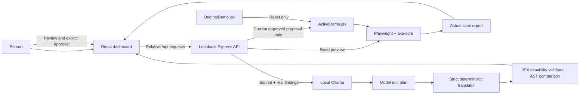

# AccessFix AI architecture

AccessFix AI supports one controlled local React component. Its workflow is **Detect → Generate → Review → Approve → Apply → Verify → Reset**. Ghost Mode presents real findings and verification outcomes without changing the security or approval boundary.

## Services and data flow

- The React/Vite client runs on `127.0.0.1:5173`. Its `/preview` route renders only `ActiveDemo.jsx`; the dashboard adds review and reporting around a separate iframe.
- Express runs on `127.0.0.1:3001`. Configuration accepts loopback HTTP service origins without credentials, queries or fragments. `PREVIEW_URL` must be `/preview` on `CLIENT_ORIGIN`.
- Ollama runs on the configured loopback origin, normally `127.0.0.1:11434`, with `qwen2.5-coder:1.5b` by default. No cloud SDK is used.
- Chromium is Playwright's bundled browser. Each scan owns and closes its browser/context resources.
- The server retains only the current scan/proposal association and baseline in memory. Restarting requires a new scan. There is no database or multi-user session isolation.

## Controlled source boundary

`demoPaths` resolves exactly two repository-owned paths: the immutable reset baseline `client/src/demo/OriginalDemo.jsx` and current preview `client/src/demo/ActiveDemo.jsx`. API input cannot select a source file, source text, scan target, selector, model URL or filesystem path.

Both demos initially contain the deliberately inaccessible login component. Its local submit handler prevents navigation and reports that no credentials were sent or stored. The fixture contains unnamed email/password inputs, an unnamed icon-only visibility button and low-contrast helper text.

The scanner and generator read source and check SHA-256 fingerprints for freshness. Generation never writes the demo. Only explicit apply and reset can change `ActiveDemo.jsx`; neither changes `OriginalDemo.jsx`.

## HTTP contracts and lifecycle

| Endpoint | Accepted input | Behavior |
| --- | --- | --- |
| `GET /api/health` | None | Original connectivity response, including compatibility field `phase: 0`. |
| `POST /api/scan` | Empty body or empty JSON object | Scans the configured preview and associates the resulting report with current source. |
| `POST /api/generate-fix` | Only the current `scanId` | Reads the fixed source and server-owned report, invokes Ollama, validates and stores a proposal. |
| `POST /api/apply-and-verify` | Matching `proposalId`, `scanId`, and literal `approved: true` | Rechecks current source and the AST allowlist, writes the proposal and performs a fresh scan. |
| `POST /api/reset` | Empty body or empty JSON object | Restores trusted original bytes, scans the preview and clears scan/proposal state. |

Unexpected fields, query options and unsupported media types fail explicitly. Unknown endpoints return JSON 404 errors. Browser origins, when present, must match `CLIENT_ORIGIN`; cross-site browser requests are rejected. Local CLI requests can omit `Origin`. These controls support a local developer prototype, not authenticated hosted access.

Scans, apply and reset are serialized. Generation has its own single-job guard, and apply/reset cannot run while generation is active. A new scan increments the session revision, invalidates the proposal and cancels any in-flight generation. Source/scan changes during inference cause stale-result rejection. The client also disables controls while their operations are pending and discards stale responses.

## Real accessibility scans

The scanner opens a fresh headless Chromium context, navigates directly to the fixed `/preview` URL without following main-frame redirects, waits for the visible ready marker and loaded fonts, checks runtime/compilation errors, and runs `@axe-core/playwright`.

Both baseline and after-scan use `accessfix-axe-v1`: a 1280 × 800 viewport, light color scheme, reduced motion and all default enabled axe rules. Contrast is not disabled. A source hash check after analysis rejects a preview that changed during the scan. Browser resources are closed on success and failure; cleanup failures are reported.

The normalized report includes `status`, `scanId`, `scannedAt`, `previewUrl`, `sourceHash`, policy/engine `configuration`, `violatedRuleCount`, `affectedElementCount`, `severityBreakdown`, `incompleteRuleCount` and `violations`.

Each violation preserves its rule ID, impact, guidance, WCAG tags and affected nodes. Nodes retain actual selectors, rendered HTML, failure summaries and axe check messages. Rule counts and unique affected-element counts are separate; a rule may affect multiple elements. Malformed analysis, navigation, browser, render or timeout failures never become zero-violation successes.

## Model generation and strict translation

`buildRepairPrompt.js` includes the actual controlled source and genuine server-owned axe findings: rule IDs, descriptions, selectors, affected HTML, failure summaries and check guidance. Source and findings are treated as data. The prompt and Ollama response schema request a typed JSON edit plan instead of regenerating the whole component.

The plan must contain exactly one edit with `operation: "set-static-color"`, `target: "styles.helper.color"`, the model's own six-digit hexadecimal `value`, `ruleId: "color-contrast"`, and a nonempty `reason` grounded in the finding. `REPAIR_PLAN_SCHEMA` exports the response schema. Deterministic code validates the operation, static property, finding association and value, binds the source helper paragraph to the actual finding's HTML, then changes only the color literal at its AST source span. Arbitrary `find`/`replace` plans, unsupported properties, extra operations and executable expressions are rejected. The translator supplies no prepared successful color and makes no accessibility claim about the chosen value.

Before translation, unrounded WCAG relative-luminance math checks the chosen color against the actual scan's background and expected threshold. The source foreground must match the scan data; unsupported/ambiguous color data is rejected. This precheck supplies no replacement value and does not replace browser verification.

The resulting complete module passes two existing gates:

1. `validateProposal.js` normalizes module text and parses JSX. `PROPOSAL_POLICY` requires a default-exported synchronous component and rejects unsupported capabilities, including non-React imports, module effects, classes/constructors, async/generator constructs, dynamic imports/execution, process/filesystem/network/storage/global access, injected HTML, embedded scripts/documents and external resource/form/link targets.
2. `assertSafeProposal` compares original and proposed ASTs. It permits only the existing static accessibility attribute additions, controlled label conversion and helper color literal change. It rejects unrelated logic, visible text, styling, expressions, JSX structure, imports and handler changes.

Legacy complete-module responses remain subject to both gates. Generated code is never evaluated by the API. These checks are a narrow prototype policy, not a general JavaScript sandbox. The gate is not weakened to accommodate model output.

`ollamaClient.js` calls local `/api/chat` with the configured exact model tag, system/user messages, the response `format` schema, `stream: false`, temperature 0.1, a 4096-token output limit and 8192-token context. Generation has bounded HTTP response/source/content sizes and an overall deadline. At most one correction request is permitted within that deadline. Empty, incomplete, malformed, oversized, unsupported or unavailable model responses are errors; none cause a fallback patch.

A proposal includes `status: "proposed"`, server-generated `proposalId`, current `scanId`, actual model identifier, `generatedAt`, `sourceHash`, exact `originalCode`, complete validated `proposedCode`, `applied: false` and `verified: false`. Typed responses also retain `editPlan`, including the model's rationale displayed for review. Edit-plan evidence remains model provenance rather than verification.

## Approval, apply and rollback

Generating or copying proposal text grants no apply permission. The dashboard requires review and a separate explicit approval action. The API requires the exact stored proposal and scan association plus `approved: true`; submitted replacement code is not accepted.

Before writing, the apply service checks source freshness and reruns the AST allowlist. The controlled write uses a temporary file and atomic replacement of `ActiveDemo.jsx`. A failed rename leaves the active source untouched and attempts temporary-file cleanup; it never falls back to writing the proposal directly. There is no post-rename read outside verification's rollback handling. The server then waits for the updated preview through the same real scan path. A compilation, runtime, scan or source-consistency failure restores the prior active source and reports the failure. Reset copies the trusted original into the active source, performs a real scan and clears associations so a new generation requires a fresh user scan.

A completed after-scan is compared by genuine rule IDs:

- `resolvedRuleIds`: present before, absent afterward.
- `remainingRuleIds`: present in both reports.
- `introducedRuleIds`: absent before, present afterward.

The response includes actual `beforeScan`, `afterScan`, model/proposal identity and the comparison. `verified-improvement` requires fewer violated rules and no introduced rule IDs; otherwise the completed comparison is `verified-with-remaining-issues`. A completed scan with remaining violations is not full accessibility compliance. A failure to complete verification is not reported as an accessibility improvement.

## Ghost Mode and frontend evidence

Ghost Mode consumes completed reports and derives **Ghost Detected**, **Awaiting Permission**, **Ghost Removed**, **Still Haunting** and **New Apparition** from actual workflow state and rule IDs. It creates no scan findings and changes no approval, source or scanner configuration.

The frontend retains the first successful scan as its baseline, updates current findings after later successful scans and clearly labels retained data after errors. Proposal review uses exact original source returned with that proposal. After apply, the UI displays the genuine after-scan and verification comparison. Reset clears in-memory presentation state and requires a fresh scan.

## Release evidence and limits

Regression tests cover configuration, scanner lifecycle, protocol bounds, generation/source association, validation, explicit approval, rollback/reset and Ghost Mode mapping. Mocked unit/HTTP tests do not prove local model success. See [demo results](demo-results.md) and [the verification record](phase4-verification.md) for the separate real Ollama/Playwright/axe run.

This prototype supports one local fixture, one current server workflow and a narrow repair policy. The typed generation path focuses on contrast and can leave the label/button findings unresolved. Model output may be invalid. Manual keyboard, screen-reader, visual and content checks remain necessary; axe results alone do not establish WCAG conformance.

The default setup performs local inference after dependency/browser/model downloads. No analytics or credential storage is implemented. Different Ollama tags or service configurations require their own privacy review. Model weights are downloaded separately under their own license; see [third-party notices](../THIRD_PARTY_NOTICES.md).
