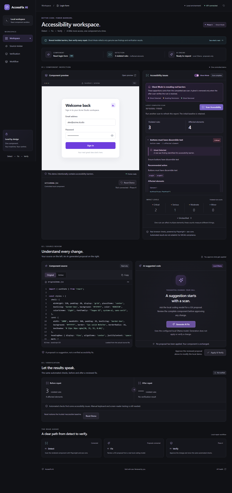
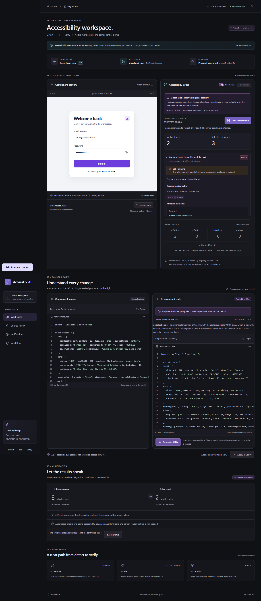

# AccessFix AI — genuine demo results

**Demo-ready: one real AI-generated repair succeeded and was repeated against the final code.** Final recording: **30 October 2026, 17:05 IST**. The model chose the change; the application did not substitute a prepared patch. The existing AST allowlist was not weakened.

## Evidence and environment

- [Full successful proof](evidence/phase6-proof.json): actual prompts/model response, proposal, scan reports, explicit approval, independent analysis, reset and source hashes.
- [Rejected first review](evidence/phase6-rejected-review.json): genuine earlier model output, canceled confirmation, rejection and cleanup reset. No repair was applied in that attempt.
- [Repeatable integration script](../scripts/e2e-proof.mjs) and [110-second recording plan](demo-script.md).
- Windows, Node.js **24.21.0**, Playwright Chromium **156.0.8078.4**, axe-core **4.14.0**.
- Actual model: **`qwen2.5-coder:1.5b`**, local Ollama at `http://127.0.0.1:11434`.
- Isolated proof API: `http://127.0.0.1:3101`; dashboard/preview: `http://127.0.0.1:5273` and `/preview`. Defaults remain 3001/5173. Another process occupied the default API port, so the proof used its own services.
- Shared scan policy: `accessfix-axe-v1`, 1280 × 800, light scheme, reduced motion, all default enabled axe rules including contrast. Dashboard screenshot viewport: 1440 × 1000.

## Actual repair and verification

| Step | Observed result |
| --- | --- |
| Initial reset | Original restored; real preview scan completed |
| Baseline scan | **3 violated rules / 4 unique affected elements** |
| Baseline rules | `button-name`, `color-contrast`, `label` |
| Generate | One real model request in the final successful run; approximately **3.94 seconds** |
| Proposed edit | `styles.helper.color`: `#a3a8b5` → **`#000000`** |
| Model rationale | Current 2.37:1 contrast is below the observed 4.5:1 threshold; black contrasts with the white background |
| Validation | Typed-operation/source/finding binding, numeric contrast check, JSX/capability validator and unchanged AST comparison gate passed |
| Review | Exact source diff reviewed; proposal-specific terminal approval recorded; browser confirmation explicitly accepted |
| Approval cancellation test | First browser confirmation canceled; **zero apply requests**; active source unchanged |
| Apply and fresh verification | **`verified-improvement`: 2 violated rules / 3 affected elements** |
| Independent browser check | Separate Playwright context and direct AxeBuilder call: **2 rules / 3 elements**, same rule IDs |
| Resolved | **`color-contrast`** |
| Remaining | **`button-name`, `label`** |
| Introduced | **None (`[]`)** |
| Rule reduction | **33%** (rounded rule-count reduction, not a WCAG score) |
| Ghost Mode | Remaining findings show **Still Haunting**; resolved contrast finding disappears from current findings; verification lists its resolved ID |
| Final reset and rescan | **3 rules / 4 elements**, same baseline rules and source hash |

Successful run identifiers:

| Record | Identifier / UTC timestamp |
| --- | --- |
| Baseline scan | `4745be3c-fccc-4461-a67f-8bb356f6fa98` / `2026-10-30T11:35:05.840Z` |
| Proposal | `91e35964-d6db-4d6c-adfd-478fcd792ece` / `2026-10-30T11:35:10.383Z` |
| Explicit approval | `2026-10-30T11:35:44.334Z` |
| After-scan | `1155ade4-cfc4-4909-9fce-f24a8977b1e5` / `2026-10-30T11:35:46.046Z` |
| Reset verification scan | `af0ac300-2f46-4ada-ac31-f823b6b45a9a` |
| Restoration rescan | `9cad57b2-499d-4f4f-91cb-2df3e187c808` / `2026-10-30T11:35:50.620Z` |

The full final successful workflow took **49.697 seconds**, including the review pause. These timings describe this machine/run, not a latency guarantee.

Both demo files started and ended with SHA-256:

```text
41b40266c8930e94dfc7f813766fe4444fd38988e1566286a9a52c5fad22e51a
```

`OriginalDemo.jsx` remained byte-identical throughout. Generation and canceled approval left `ActiveDemo.jsx` unchanged; approved application changed only its allowed color literal, with trailing-whitespace normalization. Final reset restored its original bytes. Neither demo fixture has a final Git diff.

## Honest bounded-attempt history

The saved earlier full-module proposal removed a JSX comment and dropped `style={styles.fieldText}` from both converted labels. The first actual gate rejection was `UNSUPPORTED_PROPOSED_CHANGE` for changed visible component content; removing those existing attributes is also forbidden. Later Phase 4 notes record nonmatching browser-HTML string replacements rejected as `INVALID_AI_EDIT_PLAN`; their raw later responses were not saved.

During Phase 6, the first typed proposal chose `#007bff` and incorrectly claimed 4.5:1 contrast against white. Its actual ratio is approximately **3.98:1**. Review rejected it before application. That attempt's evidence is retained above. The prompt was tightened and a numeric check added using the scan's actual background and threshold, following [WCAG contrast guidance](https://www.w3.org/WAI/WCAG22/Understanding/contrast-minimum.html). The next genuine request chose `#000000` and passed. After the final post-scan-read rollback fix, a further genuine request chose black and repeated the successful workflow. **Three real model calls total** were made: one reviewed rejection and two successful real repairs; no model swap, mock or fallback patch was used. The current proof and screenshots contain the final run.

The final raw rationale incorrectly estimates black-on-white contrast as 10:1; its actual calculated ratio is **21:1**. The reviewer accepted the edit based on the independently computed passing value and safe diff, rather than trusting that estimate. The raw response remains unchanged in the evidence. Numeric safety checks and real axe scans determine acceptance; prose from the model is untrusted explanation.

## Real screenshots

These are unaltered browser captures from the successful run, not generated artwork or fabricated UI results.





## Final regression and release status

`npm run check` passed: **74 server tests + 2 Ghost Mode tests = 76 tests**, ESLint and production build. `npm audit --json` reported **0 known vulnerabilities** at release preparation. Tests cover unsafe proposals, approval rejection, failed atomic writes, scan and post-scan read failure rollback, stale source and reset. Failure-path tests use injected dependencies; the successful model/browser workflow above uses real services.

Tracked files and all 29 reachable Git revisions were checked for high-confidence credential patterns; no matches were found. Environment examples contain local configuration without secrets. Dependencies, model weights, `.env`, build output and `.tmp` remain untracked/ignored. This is a bounded audit, not a guarantee that automated pattern matching detects every possible secret.

The repository is **technically ready for public release as a local prototype**, with the user-approved MIT license (copyright Kanwar) and model notices. These Phase 6 changes have not been committed or pushed, and no publication was performed. Public repository accessibility, video recording/upload and DEV publication remain manual. See [the verification/release record](phase4-verification.md) and [submission draft](hacktoberfest-week4-submission.md).

The two remaining rules are deliberate and disclosed. Only one controlled component and a narrow generation operation are supported. Model output may fail or make inaccurate claims. Automated testing cannot establish full WCAG conformance; manual keyboard, screen-reader and content review remain necessary. Browser/source restoration requires functioning filesystem access; failure paths report errors rather than claiming successful verification.
